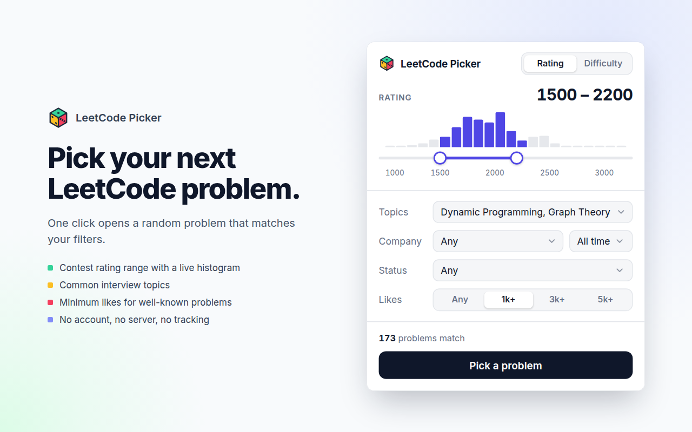
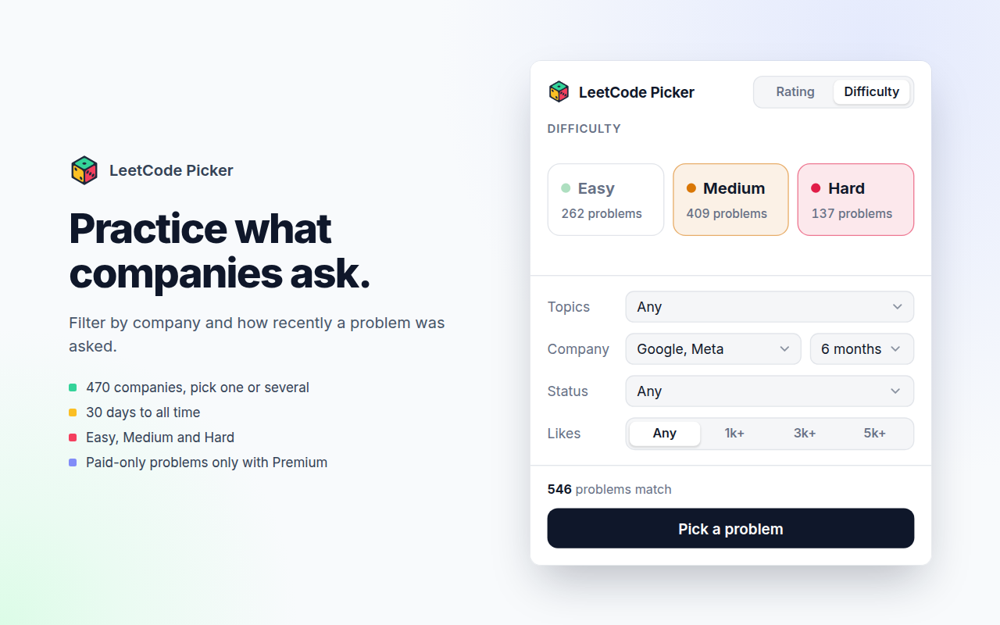

# LeetCode Picker

Chrome extension that picks a random LeetCode problem.

## Features

- Pick by contest rating range or by difficulty.
- Filter by topic, company (and how recently it was asked), solve status and minimum likes.

## Install

1. Clone this repo, or download it as a ZIP and unzip it.
2. Open `chrome://extensions` and turn on **Developer mode**.
3. Click **Load unpacked** and select the repo folder.
4. Pin LeetCode Picker from the toolbar's extensions menu. Sign in to leetcode.com to use the Status filter.

## Data

Ratings from [zerotrac/leetcode_problem_rating](https://github.com/zerotrac/leetcode_problem_rating)

Companies from [liquidslr/leetcode-company-wise-problems](https://github.com/liquidslr/leetcode-company-wise-problems)

